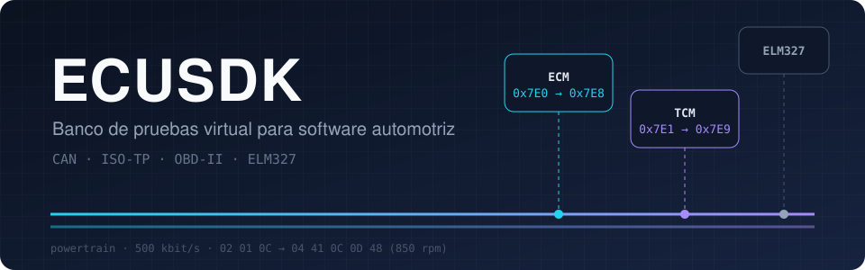
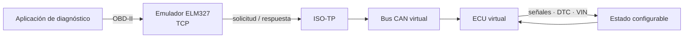
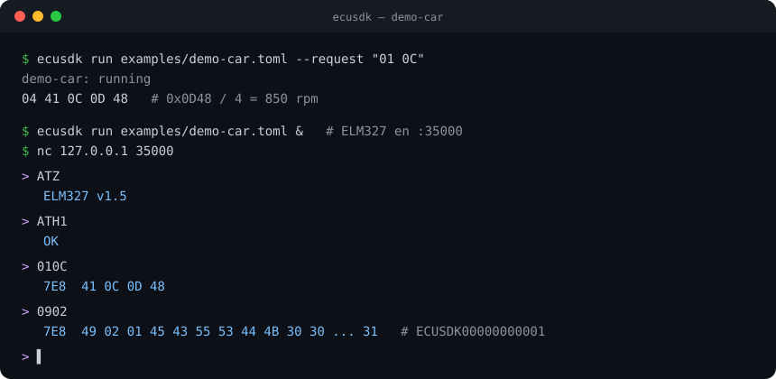
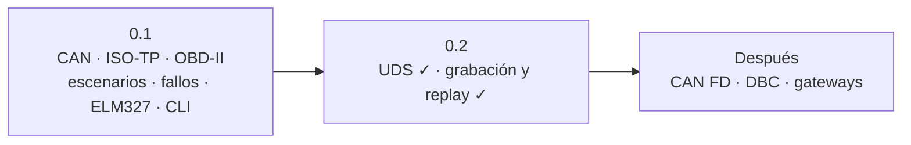

<div align="center">



<br>

Simula ECUs y conversa con ellas usando CAN, ISO-TP y OBD-II, sin depender de un vehículo físico.

**Creado por Rodar · Hecho para compartir con la comunidad**

[](https://github.com/rodar-cl/ecusdk/actions/workflows/ci.yml)
[](https://www.python.org/)
[](#métricas)
[](#métricas)
[](./pyproject.toml)
[](./pyproject.toml)
[](#alcance-y-estado)
[](./LICENSE)

[Empieza](#empieza-en-un-minuto) · [Métricas](#métricas) · [Rendimiento](#rendimiento) · [Configuración](#configura-un-vehículo) · [Protocolos](./docs/protocols.md)

</div>

ECUSDK es una herramienta interna de Rodar que ponemos a disposición de la comunidad para construir y probar software automotriz en un entorno controlado. Define un vehículo virtual con señales y ECUs configurables, y prueba el intercambio de diagnóstico a través de protocolos vehiculares.

La meta es simular lo que una aplicación puede observar en la comunicación con el vehículo: ECUSDK no ejecuta firmware original ni intenta reproducir el hardware interno de una ECU.

## Cómo funciona

Una aplicación puede consultar el vehículo simulado por OBD-II. La petición viaja por ISO-TP y CAN hasta la ECU virtual, que responde según su configuración y estado actual.



El mismo núcleo permite trabajar directamente con buses virtuales desde Python o conectar una interfaz SocketCAN explícita en Linux.

<p align="center">
  
</p>

## Empieza en un minuto

Necesitas Python 3.11 o posterior. Desde el repositorio, instala ECUSDK en modo editable:

```bash
python -m pip install -e .
```

Consulta las RPM definidas en el ejemplo incluido:

```bash
ecusdk run examples/demo-car.toml --request "01 0C"
```

La salida contiene la respuesta ISO-TP en hexadecimal (`04 41 0C 0D 48`; los primeros cuatro bytes de payload son la respuesta OBD-II y representan 850 rpm). Para iniciar el servidor ELM327 sobre TCP en `127.0.0.1:35000`:

```bash
ecusdk run examples/demo-car.toml
```

La aplicación cliente debe enviar comandos ELM327 terminados en retorno de carro (`\r`). Mientras el vehículo corre, otro terminal puede modificarlo a través del shell de control (`127.0.0.1:35001`):

```bash
ecusdk set ECM.rpm 3500          # la siguiente consulta 010C devuelve 41 0C 36 B0
ecusdk dtc ECM add P0301         # la consulta 03 devuelve el DTC
ecusdk fault ECM timeout 500ms   # la ECU deja de responder durante 500 ms
ecusdk inspect                   # estado de ECUs, señales, PIDs, DTCs y fallos
ecusdk shell                     # sesión interactiva con los mismos comandos
```

`ecusdk inspect vehiculo.toml` describe un archivo sin ejecutarlo. También puedes ejecutar una consulta de una sola vez sin iniciar el servidor:

```bash
ecusdk run examples/demo-car.toml --request "01 0D"
```

### Launcher interactivo (opcional)

Si prefieres no recordar flags, instala el extra `tui` (usa [Textual](https://textual.textualize.io)) y abre el launcher:

```bash
pip install 'ecusdk[tui]'
ecusdk tui                       # opcional: ecusdk tui mi-auto.toml
```

Es un asistente en cuatro pasos:

1. **Auto**: elige uno de `./examples` o `~/.ecusdk/vehicles`, o crea uno nuevo. *Personalizar* cambia el nombre, el VIN y los valores iniciales, y agrega o quita sensores del catálogo OBD-II. El *modo avanzado* edita todo el TOML. Antes de guardar, todo se valida con `load_vehicle`.
2. **Conexión**: Wi-Fi/TCP o Bluetooth (BLE), si aceptas conexiones desde otros dispositivos de tu red y si grabas la sesión en `.eculog`. Los puertos están en *Opciones avanzadas*.
3. **Iniciar**: muestra un resumen con la dirección a la que debe conectarse tu app.
4. **En marcha**: sensores en vivo con su valor editable, botones para simular check engine, desconexión o latencia de un módulo, pausa y reinicio, y un registro técnico con el shell de control.

### Adaptador BLE (opcional)

Para probar apps móviles que hablan con adaptadores ELM327 por Bluetooth Low Energy, instala el extra `ble` (macOS y Linux; usa [bless](https://github.com/kevincar/bless)) y añade `--ble`:

```bash
pip install 'ecusdk[ble]'
ecusdk run examples/demo-car.toml --ble
```

Se anuncia como `OBDII ecusdk` (`--ble-name`) con el GATT habitual de estos adaptadores: servicio `0BDA`, escritura en `0BDB` y notificaciones en `0BDC`. El servidor TCP sigue activo en paralelo. Las respuestas se notifican en trozos de 20 bytes (`--ble-chunk`), como un adaptador real sin MTU negociado, de modo que la app debe acumular notificaciones hasta el prompt `>`. Hace falta un teléfono físico: los simuladores de iOS y Android no tienen Bluetooth. En macOS, la terminal desde la que se ejecuta necesita permiso en *Ajustes del Sistema → Privacidad y seguridad → Bluetooth*; sin él, macOS cierra el proceso.

## Métricas

Medido sobre `main` con `uv run pytest --cov=ecusdk`.

| | |
| --- | --- |
| 🧪 Tests | **200** pasando en **1.5 s** (incluye pruebas de propiedades con Hypothesis y contrato de API) |
| 📈 Cobertura | **98 %** de líneas; CI exige ≥ 90 % |
| 🧩 Código | ~3.200 líneas en `src/` · ~2.400 líneas de tests |
| 📦 Dependencias de runtime | **0**, sólo biblioteca estándar |
| ⚡ Import | ~10 ms (`python -X importtime -c "import ecusdk"`) |
| 🔒 Tipado | Pyright en modo `strict` sobre `src` y `tests` |
| 🖥️ Matriz de CI | 3 sistemas × 4 versiones de Python = **12 jobs** por cambio |

<details>
<summary>Cobertura por módulo</summary>

| Módulo | Sentencias | Cobertura |
| --- | ---: | ---: |
| `isotp_transport.py` · `signals.py` · `errors.py` · `__init__.py` | 250 | 100 % |
| `isotp.py` · `shell.py` | 257 | 99 % |
| `simulation.py` | 531 | 98 % |
| `can.py` · `obd.py` · `config.py` · `cli.py` | 538 | 98 % |
| `faults.py` | 77 | 95 % |
| `elm327.py` | 180 | 94 % |
| `clock.py` | 26 | 92 % |
| **Total** | **1.859** | **98 %** |

</details>

Cada pull request pasa por formato y lint (Ruff), Pyright, tests con cobertura, build del wheel e instalación limpia en Linux, macOS y Windows con Python 3.11, 3.12, 3.13 y 3.14. En Linux se ejecutan además las pruebas de SocketCAN.

## Rendimiento

Todo ocurre en memoria y sin `sleep`: el reloj virtual hace que los timeouts y el STmin de ISO-TP se prueben al instante.

| Operación | p50 | p99 | Equivale a |
| --- | ---: | ---: | --- |
| Consulta OBD `01 0C` (RPM, un frame) | 15 µs | 49 µs | ~68.000 consultas/s |
| Consulta OBD `09 02` (VIN, multi-frame + Flow Control) | 32 µs | 102 µs | ~31.000 consultas/s |
| Transferencia ISO-TP de 4095 B (586 frames) | 0,65 ms | 0,69 ms | ~6,3 MB/s |
| Ida y vuelta ELM327 por TCP (`010C`) | 42 µs | 122 µs | ~24.000 comandos/s |
| 20 ECUs en un bus, consultas en rotación (PRD §56) | — | — | ~21.700 frames/s |
| CLI `ecusdk run --request "01 0C"` en frío | 33 ms | 37 ms | proceso completo |

Como referencia, un bus CAN real a 500 kbit/s transporta del orden de 4.000 frames por segundo: el simulador va muy por delante del hardware que imita.

> Apple M4, macOS, Python 3.12. Los números varían según la máquina; reprodúcelos con `uv run python examples/bench.py`.

## Configura un vehículo

El formato TOML describe el bus, las ECUs, sus señales iniciales y la asociación entre PIDs OBD-II y señales. Este fragmento corresponde a [`examples/demo-car.toml`](./examples/demo-car.toml):

```toml
[vehicle]
name = "demo-car"
vin = "ECUSDK00000000001"

[buses.powertrain]
type = "can"
bitrate = 500000

[ecus.ecm]
bus = "powertrain"

[ecus.ecm.can]
request_id = 0x7E0
response_id = 0x7E8

[ecus.ecm.signals.rpm]
initial = 850

[ecus.ecm.signals.speed]
initial = 0

[ecus.ecm.obd]
"01:0C" = "rpm"
"01:0D" = "speed"
```

La señal `rpm` alimenta el PID `01 0C`; al cambiar el estado de la ECU, la respuesta refleja el nuevo valor. Puedes definir varios buses y ECUs en un mismo vehículo.

Las señales pueden seguir un generador determinista (`constant`, `linear`, `ramp`, `sine` o `random` con seed) y un escenario puede cambiar señales e inyectar fallos en instantes concretos. [`examples/scenario-car.toml`](./examples/scenario-car.toml) muestra ambos:

```toml
[ecus.ecm.signals.rpm]
initial = 850
max = 7000
generator = { type = "ramp", start = 850, end = 3000, duration = 10, at = 5 }

[scenario]
events = [
    { at = 20, ecu = "ecm", action = "sensor_frozen", signal = "rpm", duration = 5 },
    { at = 30, ecu = "tcm", action = "ecu_offline", duration = 3 },
]
```

## Qué incluye

| Área | Disponible hoy |
| --- | --- |
| CAN | Bus virtual con nodos, filtros y timestamps; SocketCAN en Linux mediante interfaz explícita |
| ISO-TP | Direccionamiento normal, envío segmentado, Flow Control, bloques, STmin y timeouts |
| OBD-II | Mode 01 con PIDs soportados (`0100`…), RPM, velocidad, temperaturas, carga, acelerador, combustible, MAF y tensión; Mode 03/04 para DTCs; Mode 09 PID 02 para VIN |
| Simulación | Señales con generadores, reloj real o virtual, escenarios TOML deterministas con pausa, reinicio y seed |
| UDS | DiagnosticSessionControl, ECUReset, ReadDTCInformation, ReadDataByIdentifier y TesterPresent, con NRCs, sesión S3 y DIDs configurables |
| Grabación | Sesiones `.eculog` versionadas (frames, OBD/UDS, señales, DTCs, fallos, escenarios) y `ecusdk replay` con tiempos relativos o reinyección en SocketCAN |
| Fallos | ECU offline, timeout, latencia, Flow Control tardío, frames perdidos, duplicados o malformados, longitud inválida, PID incorrecto, CF perdido, secuencia errónea, interrupción ISO-TP, sensor congelado, fuera de rango e intermitente |
| Adaptador | Emulador ELM327 sobre TCP o pseudo-terminal, con consultas funcionales a varias ECUs y `ATSH` |
| Herramientas | API Python tipada y CLI `run`, `inspect`, `shell`, `get`, `set`, `dtc`, `fault` y `faults` |

Para conocer los detalles de los protocolos, límites y ejemplos de la API, consulta la [guía de protocolos](./docs/protocols.md) , la de [simulación y fallos](./docs/simulation.md) y la de [grabación](./docs/recording.md).

## Casos de uso

- Desarrollar una integración de diagnóstico antes de tener acceso a un vehículo.
- Reproducir consultas y respuestas de forma determinista durante el desarrollo.
- Probar lectura y borrado de DTCs, señales y datos de identificación del vehículo.
- Conectar clientes compatibles con ELM327 a un emulador por TCP.
- Usar un bus virtual en pruebas automatizadas o conectar SocketCAN en Linux cuando haga falta.

## Alcance y estado

ECUSDK está en `0.1.0`, su primera versión con un contrato de API probado (`tests/test_release_contract.py`). Hasta `1.0` las versiones menores pueden introducir cambios incompatibles, siempre anotados en el [CHANGELOG](./CHANGELOG.md). La versión cubre CAN, ISO-TP, OBD-II, simulación con escenarios y fallos, ELM327 y la CLI de control. En `main` ya están UDS y la grabación y reproducción de sesiones (bloque 0.2). CAN FD, importación DBC y gateways forman parte de las siguientes versiones.

El simulador modela comportamientos observables del protocolo. No emula firmware de fabricantes, un runtime AUTOSAR completo ni los componentes electrónicos de una ECU. SocketCAN requiere Linux y una interfaz preparada por quien ejecuta la herramienta.



## Desarrollo

```bash
uv sync                     # entorno con dependencias de desarrollo
uv run pytest --cov=ecusdk  # tests y cobertura
uv run ruff check . && uv run pyright
uv run python examples/bench.py
```

## Contribuye

ECUSDK se comparte para que más personas puedan experimentar, reportar problemas y aportar mejoras. Puedes abrir un issue para describir un caso de uso o enviar una pull request con cambios acotados y una explicación de cómo reproducirlos.

Son especialmente útiles los ejemplos pequeños, las correcciones de protocolo y los perfiles de vehículos ficticios o genéricos. Evita incluir datos identificables de vehículos o información propietaria.

## Uso responsable

El entorno virtual está orientado a desarrollo, aprendizaje y pruebas. El bus predeterminado es virtual. SocketCAN abre únicamente la interfaz configurada de forma explícita. Al trabajar con hardware, hazlo en un banco de pruebas seguro y autorizado; no conectes pruebas experimentales a un vehículo en circulación.

## Licencia

ECUSDK se distribuye bajo **PolyForm Noncommercial License 1.0.0**. La licencia permite los usos no comerciales definidos en sus términos; el uso comercial requiere una licencia independiente de Rodar. Lee el texto completo en [`LICENSE`](./LICENSE).

## Rodar

ECUSDK es desarrollado por [Rodar](https://rodar.cl) y se comparte con la comunidad como herramienta para aprender, experimentar y construir mejor software automotriz.

© 2026 Rodar
